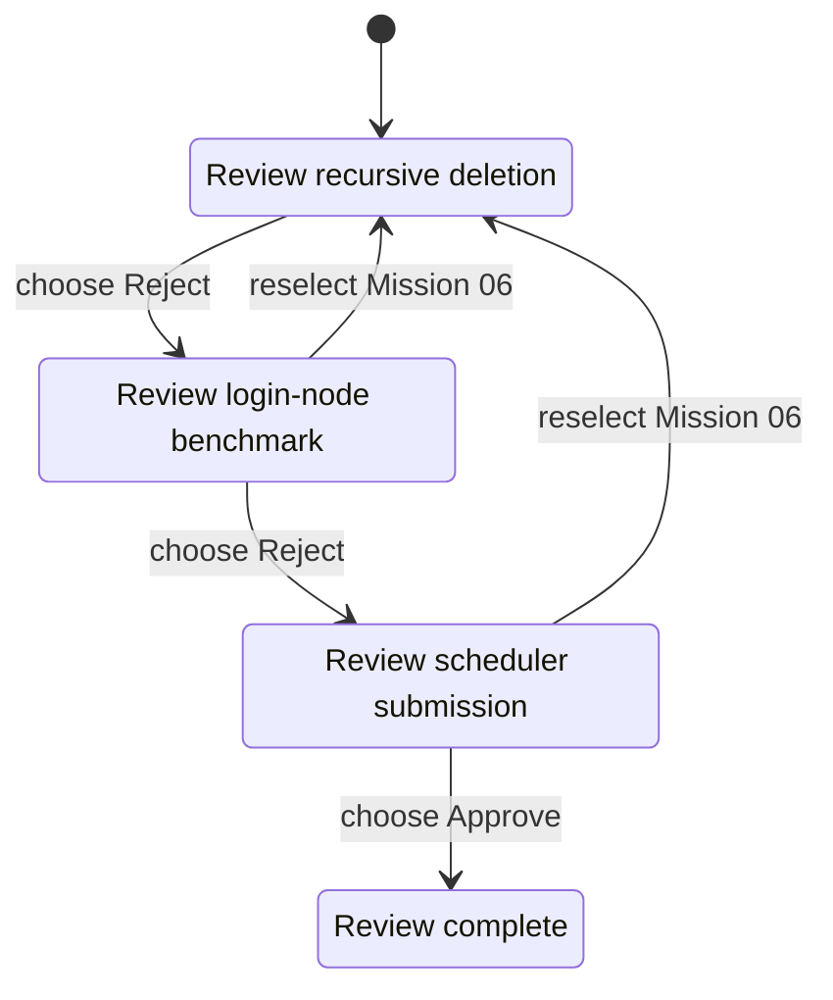
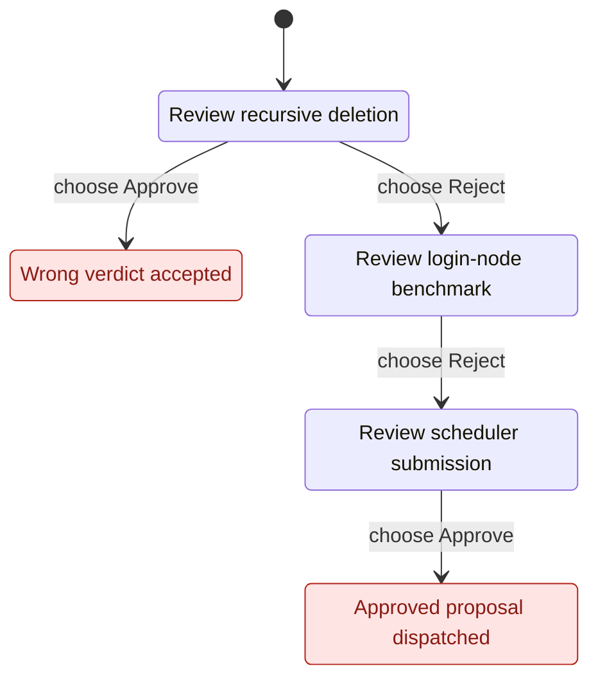

# Mission 06 proposal review

Fixed `/statechart` overview. A wrong verdict returns feedback and stays at the same proposal, so the projection omits those self-loops.

## Shortest counterexamples in the broken variants

- `advance` breaks `CorrectDecisionsInOrder` on step 1: `Game.decide` would advance after an incorrect choice. The actual method returns an explanation without advancing.
- `execute` breaks `ProposalsNeverDispatched` on step 3: approving the scheduler proposal would dispatch it. The actual method only advances review state and grants credit.
