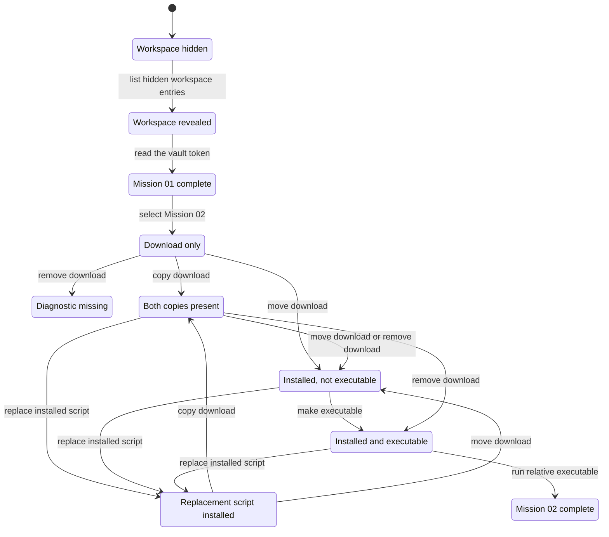
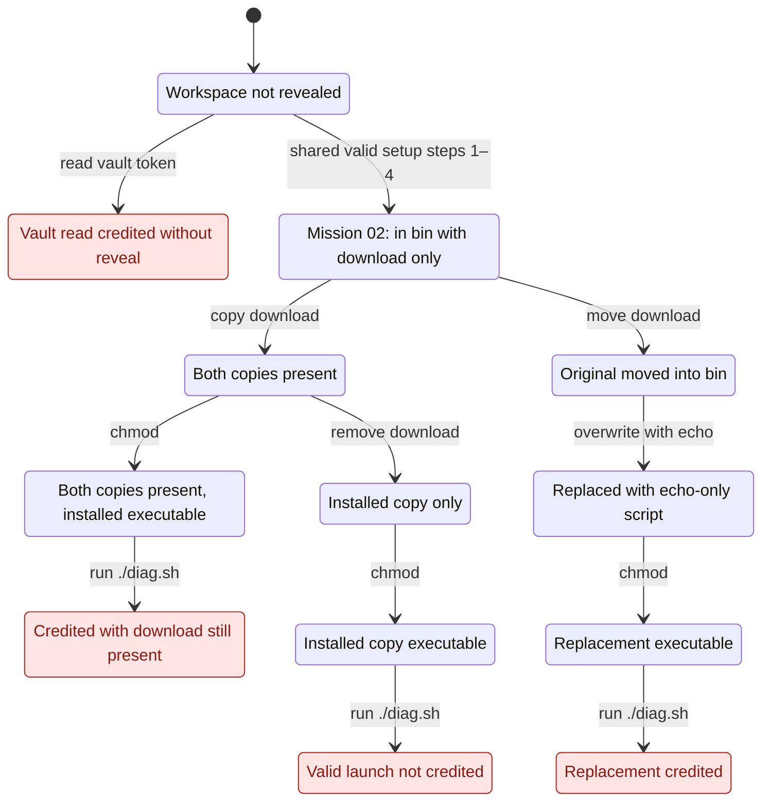

# Missions 01 and 02

The fixed overview is the `/statechart` projection. It collapses cwd, repeated commands, and non-crediting launches that stay in the same display state. The final arrow also requires cwd `~/bin`, intact content, execute permission, and successful relative execution. Completion is sticky.

## Shortest counterexamples in the broken variants

This view combines only the shortest paths reported for the four variants. Steps 1–4 for the three Mission 02 traces are shared: `ls -a`, read the vault token, select Mission 02, `cd ~/bin`. Red marks the first invariant violation, not a current finding.

- `reveal`: `RevealBeforeRead` breaks on step 1 if `level1.observe` grants credit without the successful workspace reveal.
- `leftover`: `InstallSoundness` breaks on step 7 if `level2.observe` ignores the surviving download. The fixed guard reports the leftover.
- `identity`: `InstallResponsiveness` breaks on step 8 under the old original-object rule. The fixed guard compares content.
- `content`: `InstallSoundness` breaks on step 8 if `level2.observe` trusts stdout alone. The fixed guard checks the installed text.
