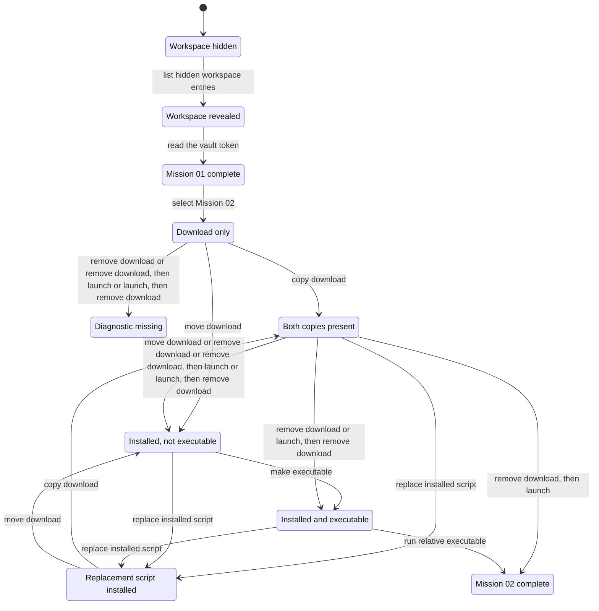
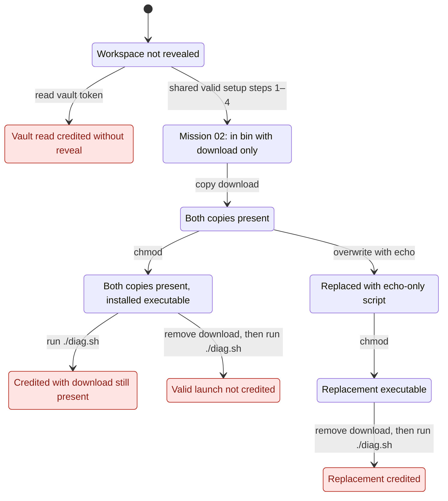
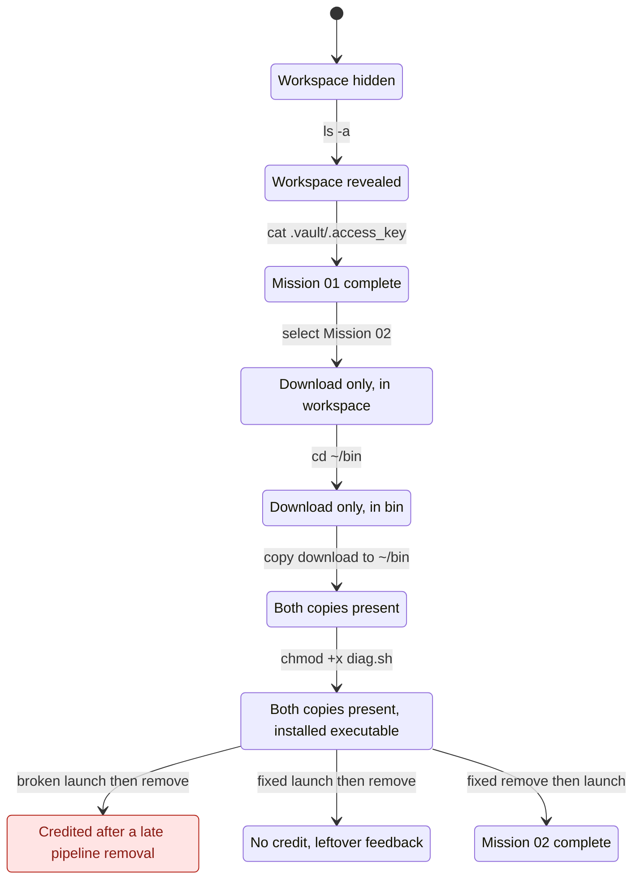

# Missions 01 and 02

The fixed overview is the `/statechart` projection. It collapses cwd, execute permission when both copies exist, and steps that stay in the same display state. Both arrows to Mission 02 completion require cwd `~/bin`, intact content, execute permission, and successful relative execution with no download at launch. Completion is sticky.

## Shortest counterexamples in the broken variants

This view combines only the shortest paths reported by `/statechart` for the four earlier variants. Steps 1–4 for the three Mission 02 traces are shared: `ls -a`, read the vault token, select Mission 02, `cd ~/bin`. Red marks the first invariant violation, not a current finding.

- `reveal`: `RevealBeforeRead` breaks on step 1 if `level1.observe` grants credit without the successful workspace reveal.
- `leftover`: `InstallSoundness` breaks on step 7 if `level2.observe` ignores the surviving download. The fixed guard reports the leftover.
- `identity`: `InstallResponsiveness` breaks on step 7 under the old original-object rule. The fixed guard compares content.
- `content`: `InstallSoundness` breaks on step 8 if `level2.observe` trusts stdout alone. The fixed guard checks the installed text. The standalone checker can choose an equally short trace using `mv` and a single-stage launch.

## Pipeline close-up: download presence at launch

The red endpoint is the shortest `pipeline` counterexample (seven submissions or selections after initialization). The other two endpoints show the fixed results from the same prepared state. In all three endpoints the download is gone after the pipeline.

- `LaunchThenRemove` (`./diag.sh | rm ~/downloads/diag.sh`) records a present `last.launchDownload` but an empty final `download`. The broken variant awards using the final value and violates `InstallSoundness`.
- `Shell.run` captures `event.vfsAtExecution` after opening redirects and immediately before executing the stage. `level2.observe` uses that evidence rather than the live VFS when `Game.run` visits the stages. It reports the leftover and rejects the late removal.
- `RemoveThenLaunch` (`rm ~/downloads/diag.sh | ./diag.sh`) records an empty `last.launchDownload`; the same install qualifies and receives credit. See `InstallResponsiveness`. Feedback itself is covered by the JS tests, not the model.
