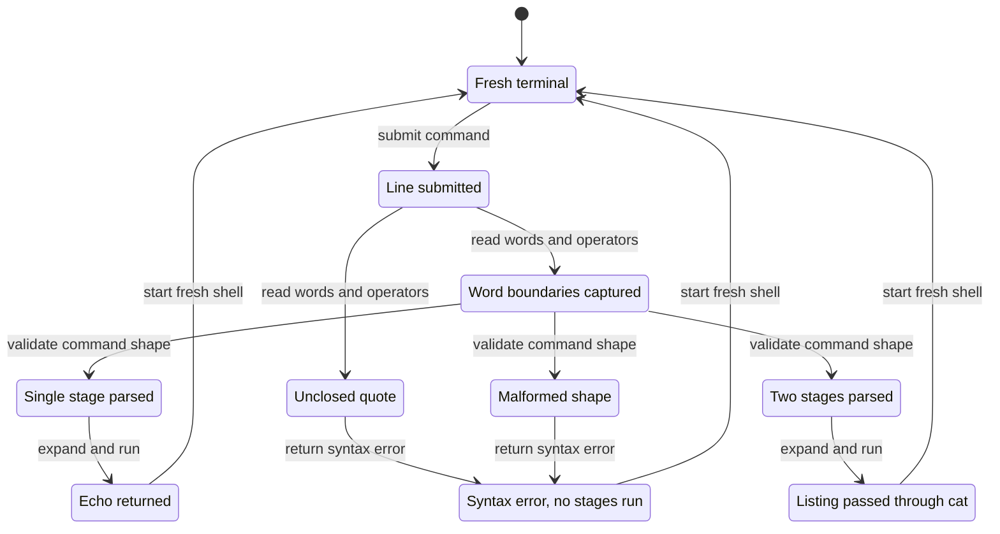
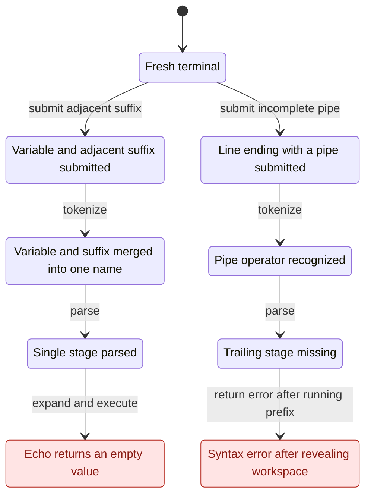

# Shell submission

Fixed `/statechart` overview. Internal phases run synchronously inside a single submission. The exit through syntax error does not enter the stage loop.

## Shortest counterexamples in the broken variants

- `quotes` breaks `ExpansionKeepsBoundaries` on step 4: `tokenize` merges `$USER` with `_lab`; `expandWord` tries to expand `USER_lab`. Quote delimiters now end the segment. `echo "$USER"_lab` and `echo $USER"_lab"` are equivalent witnesses.
- `partial` breaks `ParseBeforeEffects` on step 4: `ls -a |` reports a syntax error after applying `ls -a`. The actual `Shell.run` parses the entire line before entering its execution loop.
