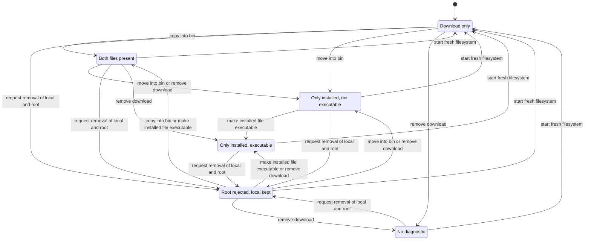
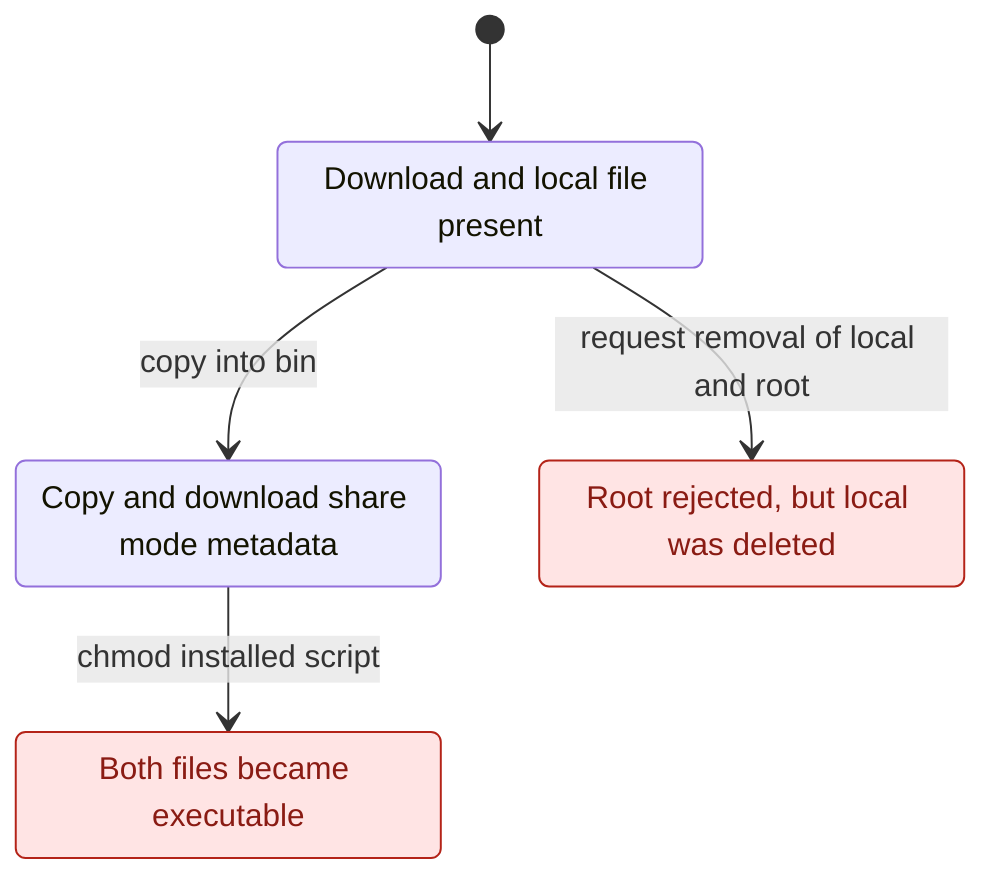

# VFS install and root refusal

Fixed `/statechart` overview. The projected states collapse operations that do not visibly change file placement; the appendage “root rejected” represents the last submission, not a separate disk mode. The model exposes the download and installed file modes even in the collapsed “Both files present” state.

## Shortest counterexamples in the broken variants

- `alias` breaks `CopyIsolatesMetadata` on step 2: `VFS.transfer` shares the file object on `cp`, so `chmod` changes the source too. The actual copy path clones the entry.
- `root` breaks `RootRefusalHasNoSideEffects` on step 1: the local operand was removed before `/` was refused. The actual `commands.rm` preflights every normalized operand.
